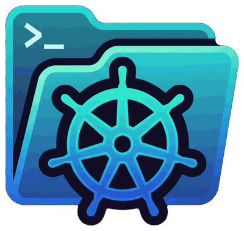
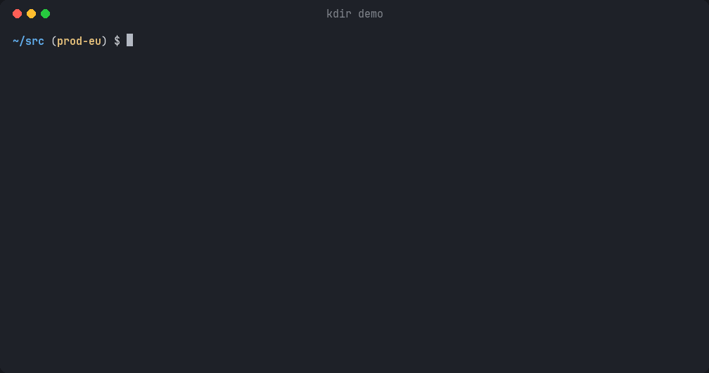

<p align="center">
  
</p>

<h1 align="center">kdir</h1>

<p align="center"><strong>Per-directory Kubernetes context and namespace, from a small file your team commits.</strong></p>

`cd` into a project and kubectl points at the cluster and namespace in its
`.kubectx`. `cd` out and everything is back to normal. Only the current shell
changes.

```yaml
# .kubectx: safe to commit, contains no credentials
server: https://ABCD1234.gr7.eu-west-1.eks.amazonaws.com
namespace: payments
```

Think `.nvmrc` for clusters, hooked into the shell like direnv.

<p align="center">
  
</p>

## Why use it

- **Committable.** The file has no credentials, so the whole team can share it.
- **Per shell.** Other terminals keep their own context.
- **Fail-closed.** If you don't have the cluster the project asks for, kubectl
  refuses to run instead of quietly using whatever was active (maybe production).
- **Safe by default.** A cloned repo's `.kubectx` does nothing until you
  `kdir allow` it. Your own kubeconfig is never written.

## Quick start

1. **Install**

   ```bash
   go install github.com/thomaschaplin/kdir/cmd/kdir@latest
   ```

   Or grab a binary from the [releases page](https://github.com/thomaschaplin/kdir/releases).

2. **Hook your shell**, then open a new one:

   ```bash
   eval "$(kdir hook zsh)"     # ~/.zshrc
   eval "$(kdir hook bash)"    # ~/.bashrc
   kdir hook fish | source     # ~/.config/fish/config.fish
   ```

3. **Set up a project** using the context you're on now:

   ```bash
   cd ~/src/payments
   kdir init --server --namespace payments
   git add .kubectx
   ```

Teammates who clone the repo run `kdir allow` once.

## The `.kubectx` file

Pick **one** way to find the context, and optionally a namespace:

```yaml
context: staging-eu          # exact context name, or
# contextRegex: "^.*staging$"  # a regex, or
# server: https://...        # the API server URL (best for teams)

namespace: payments          # optional
protect: false               # optional: confirm before delete/apply/etc.
```

kdir uses the nearest `.kubectx` above the current directory. If the matcher
finds no context, or more than one, kubectl is disabled in that directory
until it's fixed.

## Commands

| Command | What it does |
|---|---|
| `kdir init` | Create a `.kubectx` from your current context and allow it |
| `kdir allow` / `kdir deny` | Trust or stop trusting a `.kubectx` |
| `kdir status` | Show what's active here and why |
| `kdir status --short` | `context:namespace`, for your prompt |
| `kdir exec -- <cmd>` | Run one command with this directory's context (scripts, CI) |
| `kdir hook <shell>` | Print the shell hook |
| `kdir gc` | Clean up files left by exited shells |

Prompt tools like starship and kube-ps1 pick up the right context with no
extra setup.

## Learn more

- [Guide](docs/guide.md): file format, how isolation works, trust,
  `protect`, scripts and CI, prompts, limitations
- [Compared with direnv, kubie, kubesess, kubech](docs/guide.md#compared-with-other-tools)
- [Benchmarks](docs/benchmarks.md): about 6 ms per prompt
- [Development and releasing](docs/development.md)

Supports macOS and Linux with zsh, bash and fish.

## License

[MIT](LICENSE)
